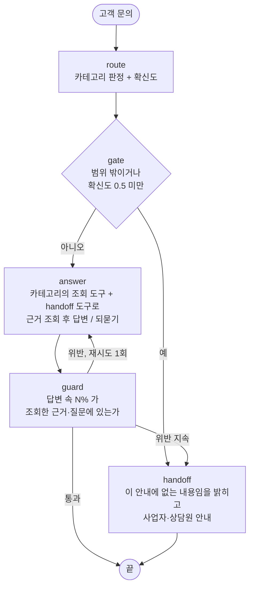
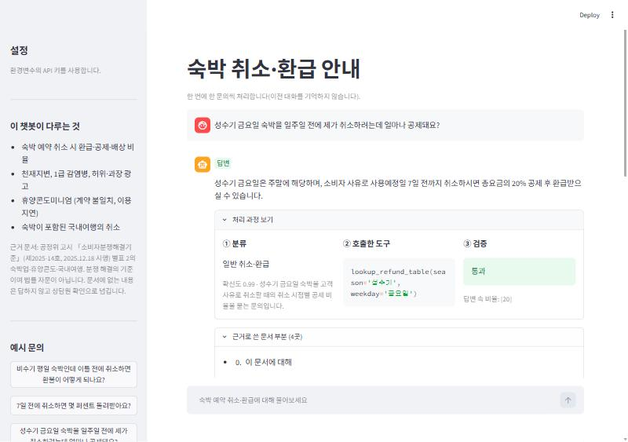

# 숙박 취소·환급 안내 챗봇 — 라우팅과 그라운딩 프로젝트 보고서

고객 문의 한 줄을 받아 **분류하고 → 근거 문서에서 필요한 부분만 조회하고 → 근거로만 답하고 → 수치를 검증**하며,
문서에 없으면 지어내지 않고 **되묻거나 상담원 확인으로 넘기는** 챗봇이다.

| 지표 (현재 코드 기준 최종 재측정) | 평가용 22건 | 보류 30건 |
| --- | --- | --- |
| 분류 정확도 | 100% | 96.7% (29/30) |
| ① 도구 호출 적절성 | 95.5% (21/22) | 90.0% (27/30) |
| ② 답변 적절성 | 100% (22/22) | 96.7% (29/30) |
| 둘 다 통과 | 95.5% (21/22) | 90.0% (27/30) |

> 주의: 평가용 22건은 개선 실험 중에 반복해서 보고 규칙을 고쳤으므로 **개발용**이다. 일반 성능은 보류 30건으로 보아야 하고,
> 보류에서의 기준선 대비 개선은 작다(4.4). 아래 4장에서 이유와 한계를 적었다.
> 위 수치는 11-02 측정이고, 11-03에 같은 코드로 다시 재자 평가용이 86~91%로 낮게 나왔다(4.6, 모델 쪽 변화로 추정).

## 1. 주제와 근거 문서

**주제**: 숙박 예약 취소·환급 안내. 사용자가 가장 자주 겪는 "취소하면 얼마를 돌려받나"를 다룬다.

**왜 골랐나**
- 규정(분쟁해결기준)에 구간별 비율표가 있어, 비율을 **지어내면 바로 틀린다**. 검증과 "문서에 없으면 넘기기"의 필요가 분명하다.
- 같은 "7일 전 취소"도 성수기/비수기, 주중/주말, 귀책에 따라 답이 갈려서 **되묻기**가 필요한 질문이 자연스럽게 생긴다.
- 문서에 없는데 그럴듯하게 답할 수 있는 질문(환불 입금 소요일, 플랫폼 자체 정책, 콘도 취소 공제율)이 많다.

**근거 문서**: `docs/lodging_dispute_standard.md`
- 출처: 공정거래위원회고시 「소비자분쟁해결기준」 [별표 2] 품목별 해결기준의 "8. 숙박·여행·골프장 관련" 중
  숙박업, 휴양콘도미니엄업, 국내여행. 고시 제2025-14호(2025.12.18 시행, 일부개정). 국가법령정보센터에서 내려받은 PDF의 76~81쪽.
- 고시는 저작권법상 보호되지 않는 법령류라서 근거 문서로 쓰고 레포에 포함할 수 있다. 분쟁 해결의 기준이며 법률 자문이 아니다.
- 표를 읽기 쉬운 마크다운으로 옮겼고, **환급률 대응(어느 시점에 몇 %)은 원본 PDF 화면과 쪽마다 대조해 확인했다**
  (텍스트 추출은 표의 열이 따로 풀려서 나와, 그대로 쓰면 비율이 어긋날 수 있었다).
- 처음 받은 한국소비자원 PDF는 2019년 판이고 글자가 깨져 쓰지 않았다.

한계: 근거 문서가 원문 6쪽 분량으로 짧다. 그래서 카테고리 간 겹침(일반 취소 vs 천재지변, 패키지 vs 천재지변)이 분류와 도구 선택의 주된 어려움이 된다.

## 2. 카테고리 설계

| 카테고리 | 답하는 내용 | 근거 문서 연결 | 조회 도구 |
| --- | --- | --- | --- |
| `REFUND_RATE` 일반 취소·환급 | 취소 시점, 성수기/비수기, 주중/주말, 귀책별 공제율·배상 | 1장 (1.1~1.5) | `lookup_refund_table` |
| `SPECIAL_CASE` 천재지변·감염병·광고 | 천재지변 당일 취소, 1급 감염병, 허위·과장 광고 | 2장 (2.1~2.3) | `lookup_special_cases` |
| `CONDO` 휴양콘도 | 계약 불일치, 이용 지연 보상, 부당 이용료 | 3장 | `lookup_condo` |
| `PACKAGE` 국내여행 패키지 | 당일·숙박여행 취소, 인원 미달, 여행 중 피해, 감염병 | 4장 (4.1~4.5) | `lookup_package` |
| `OUT_OF_SCOPE` 범위 밖 | 해외, 항공, 렌터카, 플랫폼 자체 정책, 입금 소요일, 개별 숙소 정보 | 연결 없음 | `handoff` |

**분류 근거**
- 문서의 구분(숙박업 / 휴양콘도 / 여행업)을 기본 축으로 삼았다.
- 같은 숙박업 안에서는 **계산이 필요한 일반 취소**(1장)와 **요건이 붙는 특수 사유**(2장)를 나눴다. 답하는 방식이 다르다
  (표에서 값을 고르는가, 요건을 설명하는가).
- 연결할 문서가 없는 질문을 담는 `OUT_OF_SCOPE` 를 따로 두었고, 이 카테고리는 조회 없이 바로 넘긴다.
- 분류 지침에는 혼동하기 쉬운 경계를 명시했다. 콘도의 취소 문의는 `CONDO`, 숙박이 포함된 패키지는 `PACKAGE`,
  취소 사유로 천재지변·감염병·광고가 직접 나오면 `SPECIAL_CASE`.

**근거 조립** (`context.py`)
- 문서 전체를 넣지 않고 카테고리에 필요한 장만 조립한다. 환급표는 성수기/비수기, 주중/주말을 알면 **해당 표 한 개 + 구간 구분 비고**만
  준다(예: 비수기·주말이면 1.4와 1.5만, 약 1,000자). 다른 구간의 표가 섞이면 비슷한 숫자를 잘못 고르기 쉽다.
- 주중/주말 판단은 모델이 아니라 도구가 요일로 정한다(금·토와 공휴일 전일은 주말). 실험 1에서 이유를 설명한다.

## 3. 평가셋 설계

`data/goldenset.json` — 총 62건.

| 묶음 | 건수 | 용도 |
| --- | --- | --- |
| `fewshot` | 10 | 프롬프트 예시로 쓴다. 카테고리당 2건 |
| `eval` | 22 | 개선 실험 중 반복 측정. 사실상 개발용 |
| `holdout` | 30 | 튜닝 중에는 보지 않고 확인용으로 잰다 (H-01~H-30, 10건씩 3차에 걸쳐 작성) |

- 평가용 22건: REFUND 6, SPECIAL 4, CONDO 3, PACKAGE 5, OUT_OF_SCOPE 4. 행동은 ANSWER 15, ASK 2, HANDOFF 5.
- 보류 30건: REFUND 8, PACKAGE 8, SPECIAL 5, OUT_OF_SCOPE 5, CONDO 4. 행동은 ANSWER 17, ASK 5, HANDOFF 8.

**문항마다 적은 것**
- 기대 행동: `ANSWER`(근거를 조회해서 답함) / `ASK`(조회에 필요한 값이 없어 도구 없이 되물음) / `HANDOFF`(문서에 근거가 없어 넘김).
- **기대 도구**: 호출한 도구 집합이 **정확히 같아야** 1점이다.
  되묻기는 `[]`, 범위 밖은 `[handoff]`, 카테고리 안이지만 문서에 규정이 없으면 `[조회 도구, handoff]`.
- **반드시 담아야 할 사실**(`must`): 표에서 직접 가져온 비율과 요건. 표현이 달라도 의미가 같으면 인정한다.
- **말하면 안 되는 것**(`forbid`): 문서를 안 읽거나 구간을 혼동했을 때 나오기 쉬운 **그럴듯한 오답**.
  예: 성수기 주말 문항의 금지 항목에 성수기 주중의 값(30%)을 넣었다.
- 모범 답안(`reference`), 문서 근거 위치(`doc_ref`), 문항을 넣은 이유(`why`).

**기대 도구와 필수 사실의 근거**: 모두 `docs/` 의 표에서 직접 가져왔다. 문항을 쓴 뒤 모든 정답을 문서와 문항별로 대조했고,
그 과정에서 R-02의 설명 오류("7일 전은 0~60%" → 실제로는 0~20%)를 찾아 고쳤다.

**변별력을 위해 넣은 문항**
- 문서의 정의를 모르면 틀리는 것: 금요일은 주말, 일요일은 주중(R-04, R-06).
- 값이 빠져서 되물어야 하는 것(R-02, R-08, P-07, H-03, H-13, H-14, H-23, H-30)과 값이 다 있어서 되물으면 안 되는 것(R-07, H-16, H-24).
- 문서에 없는데 그럴듯하게 답하기 쉬운 것: 콘도 취소 공제율(C-04, H-11, H-21), 지체이율(C-05), 인원 미달 통지 일수(H-12), 입금 소요일(O-04).
- 요건이 두 겹이라 단정하면 틀리는 것: 경보 발령과 이동 불가(S-03, S-06, H-05).
- 두 항목을 섞기 쉬운 것: 계약 불일치 vs 지연보상금(H-06), 패키지 천재지변(H-17).

**예시용과 평가용 분리**
- 프롬프트 예시는 `fewshot` 10건에서만 가져온다. `prompts.py` 가 `split == "fewshot"` 만 불러오며, 다른 묶음이 섞이면 실행이 멈춘다.
- 검증 스크립트(`scripts/validate_goldenset.py`)가 id 중복, 도구 이름, ASK/HANDOFF 규칙, 예시와 평가 질문의 중복을 검사한다.

**채점기**
- 도구 호출 적절성: 집합 일치(기계적).
- 답변 적절성: LLM 채점기가 `must` 를 모두 담았는지, `forbid` 를 어기지 않았는지를 **표현이 아니라 사실**로 판정한다.
- **채점기 자체 검증**: 모범 답안 22건은 모두 합격해야 하고, 다른 문항의 모범 답안을 가져와 채점하면 모두 탈락해야 한다.
  결과는 22/22 합격, 22/22 탈락(`runs/logs/runs_final_eval.txt`). 보류 30건의 모범 답안도 모두 합격하는지 따로 확인했다(30/30).

**채점기의 한계**: 의미가 같은 표현을 엄격하게 본 경우가 있었다(H-14: "요일"과 "주중/주말"). 반대로 느슨해질 수도 있어서,
점수 차이가 작을 때는 판정 근거를 직접 읽었다.

## 4. 측정 결과

### 4.1 파이프라인과 지표

- ① 도구 호출 적절성: 호출한 도구 집합이 기대와 정확히 같으면 1점. 필요한 근거를 안 읽은 것, 관련 없는 근거를 훑은 것,
  넘겨야 하는데 지어낸 것이 이 하나로 걸린다.
- ② 답변 적절성: 반드시 담을 사실을 모두 담고 금지 사항을 하나도 안 어기면 1점.
- 모든 개선은 **한 번에 하나씩** 바꾸고 **두 번씩** 쟀다(LLM 호출이라 매번 조금씩 다르다). 원본 결과는 `runs/*.json`, 로그는 `runs/logs/runs_*.txt`,
  실험별 코드는 `_versions/` 에 백업했다. 자세한 기록은 `EXPERIMENTS.md`.

### 4.2 기준선과 틀린 건의 원인 분류

기준선(둘 다 통과 72.7% / 68.2%, 분류 100%)에서 틀린 건을 직접 읽고 원인을 나눴다.

| 문항 | 증상 | 원인 | 고친 곳 |
| --- | --- | --- | --- |
| R-06 | 일요일 숙박을 주말(30%)로 답함 | 요일→주중/주말 판단을 모델이 틀림 | 요일 판단을 도구로 (실험 1) |
| R-07 | 어느 구간이든 답이 같은데 되물음 | 되묻기 기준이 없음 | 되묻기 기준 (실험 2) |
| C-04 | 문서에 없는 콘도 취소 공제율을 되물음 | 표가 없는 주제인데 값이 빠졌다고 되물음 | 되묻기 기준 (실험 2) |
| P-07 | 되물을 값 3개 중 2개만 물음 | 답을 바꾸는 값을 다 묻지 않음 | 되묻기 기준 (실험 2) |
| S-04 | "1급 감염병" 요건을 빼고 답함 | 적용 요건을 안 밝힘 | 실험 2 이후 해소(별도 실험 없이 통과) |
| C-03, C-05 | 답하고도 handoff 를 한 번 더 부름 | 넘기기 규칙이 과함 | 넘기기 규칙 (실험 3) |

### 4.3 개선 시도 기록 (평가용 22건, 두 번씩)

| # | 바꾼 것 | ① 도구 | ② 답변 | 둘 다 | 메모 |
| --- | --- | --- | --- | --- | --- |
| 0 | 기준선 | 86.4 / 81.8 | 81.8 / 77.3 | 72.7 / 68.2 | |
| 1 | 요일→주중/주말을 도구로 (`weekday` 인자) | 86.4 / 86.4 | 86.4 / 90.9 | 77.3 / 77.3 | R-06의 오답(30%)이 20%로 고쳐짐 |
| 2 | 되묻기 기준 명시 (표가 있는 두 주제만 되묻고, 빠진 값은 한꺼번에, 나머지는 먼저 조회) | 90.9 / 90.9 | 100 / 100 | 90.9 / 90.9 | 효과가 가장 컸다 |
| 3 | 넘기기 규칙 (질문의 핵심이 문서에 없을 때만) | 100 / 100 | 100 / 95.5 | 100 / 95.5 | |
| 4 | 넘기기를 후처리 게이트로 | 90.9 / 95.5 | 90.9 / 100 | 86.4 / 95.5 | **철회**. 아래 참고 |
| 최종 재측정 | 실험 3 설정, 현재 코드 | 95.5 | 100 | 95.5 | C-04 한 건 실패(`handoff` 미호출) |

**실험 1의 효과**: 모델이 `lookup_refund_table(season='비수기', weekday='일요일')` 처럼 요일을 넘기면 도구가 주중 표(1.3)를 고른다.
**실험 2의 효과**: C-04, P-07, R-06, S-04가 한꺼번에 해결됐다.

**실험 4(게이트)를 철회한 이유**: 답변 모델에서 `handoff` 도구를 빼고 "질문의 핵심에 답했는가"를 별도 모델 호출로 판정해
넘기게 했다. 이미 본 H-11, H-12는 해결됐지만 한 번도 보지 않은 새 보류 문항에서는 오히려 낮았다
(둘 다 통과 90 / 80, 게이트 이전은 100 / 100). 새 실패 두 가지가 생겼다.
- 모델에서 `handoff` 를 빼자 조회 없이 "문서에 없다"고 답했다(H-21, C-04). 도구가 있을 때는 먼저 조회했다.
- 답하고 "금액은 문서에 없다"고 덧붙인 답을 게이트가 핵심 미답으로 판정했다(H-27, P-05).

표본이 작아 노이즈일 수 있지만, 어느 묶음에서도 게이트 이전보다 낫지 않았고 호출만 한 번 늘었다. 그래서 게이트를 되돌렸다.

### 4.4 보류 문항으로 본 일반화 — 정직한 평가

평가용 22건의 개선(72.7% → 약 95~100%)은 **그 문항을 보며 규칙을 고친 결과**라서 그대로 믿을 수 없다. 그래서 튜닝 중에 보지 않은 문항을
따로 두고 같은 설정을 비교했다(둘 다 통과 기준).

| 보류 묶음 | 기준선 | 게이트 이전(최종 설정) | 비고 |
| --- | --- | --- | --- |
| H-01~H-10 (쉬운 문항) | 90 / 100 | 100 / 100 | 기준선도 거의 다 맞힘 |
| H-11~H-20 (기준선이 약했던 유형을 겨냥) | 70 / 80 | 70 / 70 | 개선 없음 |
| H-21~H-30 (결과를 보기 전에 새로 작성) | 90 / 80 | 100 / 100 | |
| 30건 합계 | 83% / 87% | 90% / 90% (최종 재측정 90%) | 차이 3~7%p, 노이즈 범위 |

**결론**
- 보류 30건에서 기준선 대비 개선은 **작고(3~7%p) 확정적이지 않다.**
- **일반화된 것**: 실험 2의 되묻기 개선. 기준선은 패키지 취소(H-13)에서 "취소하는 쪽"을 묻지 않았고, 최종 설정은 묻는다.
- **일반화되지 않은 것**: 넘기기 개선. 문서에 없다고 답하면서 `handoff` 도구를 안 부르는 경우가 남아 있다(H-11, H-12, C-04).
- 그래서 점수는 "평가용 100%"가 아니라 **"보류 30건 90%, 기준선은 83~87%"** 로 읽어야 한다.

### 4.5 남아 있는 실패 (최종 설정)

| 문항 | 증상 | 해석 |
| --- | --- | --- |
| C-04, H-11, H-12 | "문서에 없다"고 답하고 확인처도 안내했지만 `handoff` 도구는 부르지 않음 | 답은 맞는데 도구 집합이 달라 ① 에서 감점. 넘기기를 도구 호출로 판정하는 방식의 불안정 |
| H-17 | 태풍으로 취소된 패키지를 천재지변(`SPECIAL_CASE`)으로 분류 | 문서가 짧아 패키지와 천재지변의 경계가 겹침. 분류가 가끔 흔들림 |
| 열린 질문 C-05 | 계산식은 답하고 이율은 없다며 `handoff` 까지 호출 | 평가셋의 기대(`[lookup_condo]`)와 모델의 판단이 갈림. **결과를 본 뒤 기대를 바꾸면 점수만 오르므로 바꾸지 않았다** |

### 4.6 재현성 주의 — 같은 코드의 점수가 시간이 지나며 달라졌다

보고서의 수치는 2026-11-02에 측정했다. 이튿날(11-03) 견고성 처리를 추가한 뒤 회귀를 확인하려고 평가용 22건을 다시 쟀더니
점수가 낮았다.

| 측정 | 코드 | 시점 | 둘 다 통과 (평가용 22건) |
| --- | --- | --- | --- |
| 실험 3, 최종 재측정 | 변경 전 | 11-02 | 100 / 95.5 / 95.5 |
| 회귀 확인 1, 2회차 | 견고성 처리 추가 | 11-03 | 90.9 / 86.4 |

**원인을 가렸다**: 변경 전 코드(공개 레포 그대로)로 같은 날(11-03) 의심 문항 3개를 세 번씩 다시 재 봤다.

| 문항 | 11-02 (같은 설정: 실험 3 두 번 + 최종 재측정) | 11-03 (변경 전 코드, 3회) |
| --- | --- | --- |
| S-05 | 3/3 통과 | 0/3 (연기 시 위약금 없다는 문장이 빠짐) |
| C-05 | 3/3 통과 | 0/3 (`handoff` 를 추가로 부름) |
| S-03 | 2/3 통과 | 2/3 통과 (차이 없음. 11-02에도 가끔 틀렸다) |

**결론**: 견고성 처리 때문이 아니다. 같은 코드가 며칠 사이에 다르게 동작했다. 추정 원인은 모델 쪽 변화(같은 모델 이름이
가리키는 가중치가 바뀌었거나 응답이 달라짐)이지만 **증명하지는 못했다.** 따라서

- 이 보고서의 수치는 "11-02 시점의 측정"이고, 지금 clone해서 돌리면 평가용 점수가 5~10%p 낮게 나올 수 있다.
- 한 번 재고 판단하지 않고 두 번 쟀던 이유와 같은 맥락에서, 5%p 안팎의 차이는 개선이나 퇴보의 근거가 되지 못한다.
- 뚜렷하게 달라진 문항은 S-05와 C-05 둘이다. 유형이 "필요한 한 문장을 빠뜨리기"와 "답하고도 넘기기 도구를 추가로 부르기"라서,
  실험 3에서 고친 두 행동이 모델 변화에 민감하다는 점도 시사한다. S-03은 11-02에도 가끔 틀렸으므로 변화로 보지 않는다.
- 로그는 `runs/logs/runs_robust_eval*.txt` 에 있다.

## 5. 파이프라인 구조도

LangGraph, 최종 설정(`agent.py`).

**State** (`AgentState`)

| 필드 | 채우는 노드 | 내용 |
| --- | --- | --- |
| `question` | 입력 | 고객 문의 한 줄 |
| `category`, `confidence`, `route_reason` | route | 5개 카테고리 중 하나, 확신도, 근거 |
| `action` | answer / handoff | `ANSWER` / `ASK` / `HANDOFF` |
| `tools_called`, `tool_args` | answer | 호출한 도구와 인자 |
| `evidence`, `sections` | answer | 조회한 근거 본문, 근거로 쓴 문서 부분 |
| `answer` | answer / handoff | 고객에게 나가는 답변 |
| `guard`, `feedback`, `attempts` | guard | 검증 결과, 재생성 지시, 시도 횟수 |

**노드와 판단의 분리**
- `route`(모델)는 분류만, `gate`(정책)는 처리/넘기기를 정한다. 임계값을 바꿔도 모델을 다시 부르지 않는다.
- 되묻기는 모델이 정한다. 호출한 조회 도구가 하나도 없으면 `ASK` 로 본다.
- `guard` 는 답변의 `N%` 가 근거나 질문에 없으면 위반으로 보고 한 번 다시 생성시킨 뒤, 그래도 위반이면 안전한 문구로 넘긴다.
  **한계**: 숫자가 아닌 오류(귀책 혼동, 구간 오판)는 못 잡는다.

## 6. 데모 설계

`streamlit run app.py` (`app.py`). 화면 캡처: `assets/demo_answer.jpg`.

**신경 쓴 부분**
- **과정 공개**: 답변만 보여 주지 않고 ① 분류(카테고리·확신도·근거), ② **호출한 도구와 인자**
  (`lookup_refund_table(season='성수기', weekday='금요일')`), ③ 검증 결과, **근거로 쓴 문서 부분**(절 목록과 본문)을 함께 보여 준다.
  사용자가 "왜 20%인가"를 문서로 확인할 수 있다.
- **행동 배지**: 답변(초록), 되묻기(파랑), 상담원 연결(주황)로 나눠 보여 준다. 되묻기와 넘기기도 정상 동작임을 알 수 있다.
- **예시 문의** 7개를 사이드바에 두었다(답변, 되묻기, 천재지변, 콘도, 패키지, 범위 밖 포함).
- **범위와 한계 안내**: 다루는 범위, 근거 문서 출처(고시 번호와 시행일), "법률 자문이 아니며 문서에 없는 내용은 상담원 확인으로 넘긴다"를 사이드바에 적었다.
- **API 키**: 환경변수나 입력칸으로 받고 저장하지 않는다. 오류(키 오류, 요청 한도)는 화면에 그대로 알린다.
- **보안**: 개발 중 서버가 모든 네트워크 주소에 열려 있는 것을 발견해 바로 종료하고 `--server.address localhost` 로 다시 열었다.
  이 서버는 환경변수의 키로 동작하므로 외부에 열면 안 된다.

한계: 한 번에 한 문의만 처리하고 이전 대화를 기억하지 않는다(화면에 안내). 되묻는 질문에 답하면 새 문의로 처리되므로, 처음부터 값을 함께 써야 한다.

## 7. 프로젝트 회고

**가장 공들인 부분**
1. **근거 문서의 정확성**: 뉴스 기사에는 수치가 서로 달라 원문이 필요했다. 법제처 PDF를 받아 쓰고, 표의 열이 어긋나는 문제를
   원본 화면과 쪽마다 대조해서 막았다. 근거가 틀리면 평가셋의 정답도 틀리기 때문이다.
2. **평가의 정직함**: 평가용 점수가 올라도 그것이 일반 성능이 아님을 보류 문항으로 확인했다. 결과를 보고 프롬프트를 고치면
   그 문항이 개발용이 되므로, 보류 평가에서는 고치지 않고 기록만 했다. 그 결과 "평가용 100%"가 보류에서는 90%였고 기준선과 차이가 작다는 것을 알았다.
3. **채점기 검증**: 채점기가 모범 답안은 통과시키고 엉뚱한 답은 떨어뜨리는지 먼저 확인했다.

**배운 것**
- 증상이 같아도 원인은 다르다. "요일을 틀림"은 프롬프트가 아니라 **판단을 코드로 옮겨야** 고쳐졌다.
- 도구 호출을 프롬프트로 유도하는 방식은 표현에 민감하다. 이를 게이트로 바꿔 봤지만 새 실패가 생겼고, 철회했다.
  "구조적 대안이 항상 낫지는 않다"는 것도 배웠다.
- 채점 방식이 행동을 정의한다. 도구 집합이 정확히 같아야 점수를 받으므로, 답이 맞아도 도구가 다르면 감점이다.
  이 규칙이 옳은지(문서에 없다고 정확히 답했는데 `handoff` 를 안 불렀다고 감점해야 하는가)는 논쟁의 여지가 있다.

**한계**
- 근거 문서가 짧아 카테고리 경계가 겹치고, 평가셋(62건)이 작아 1~2건 차이가 5~10%p를 만든다. 결과가 노이즈에 가깝다.
- 평가용 문항을 보며 규칙을 고쳤고, 일반화 근거는 보류 30건뿐이며 그마저 일부는 게이트 실험 중에 결과를 봤다.
- C-05처럼 평가셋의 기대가 애매한 문항이 있다.
- 숫자 검증(guard)은 비율만 본다.

**향후 개선**
- 문서 보강: 휴양콘도 취소 기준, 약관의 환급 소요 기간 등 실제 서비스에 필요한 문서 추가. 문서가 늘면 카테고리 경계도 더 선명해진다.
- 성수기 판단도 코드로: 날짜를 받아 문서의 성수기 기간(7.15~8.24, 12.20~2.20)으로 판정. 요일과 같은 방식.
- 넘기기 판정을 안정화: 도구 호출이 아닌 다른 신호로 판정하되, 이번에 본 두 가지 실패(조회 생략, 부분 답변 오판)를 막는 방법을 찾는다.
- 멀티턴 지원: 되묻기에 대한 답을 이어 받아 처리한다.
- 평가셋 확대와 사람이 검토한 채점 보정, 근거 문장 단위 인용(답변이 문서의 어느 문장에 기대는지).
